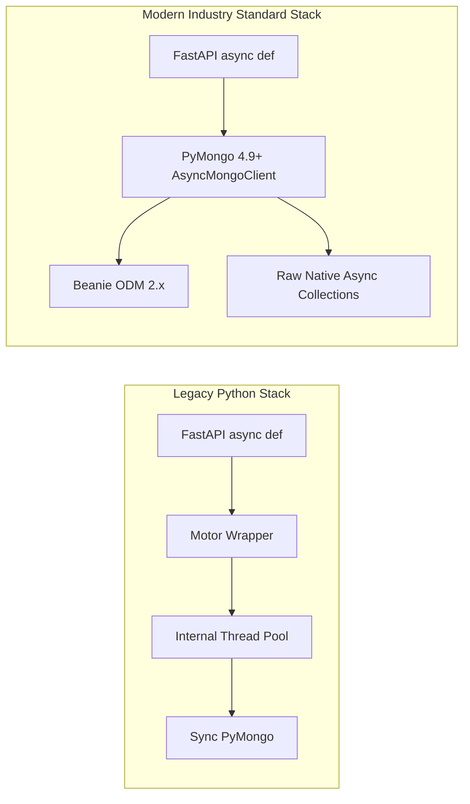
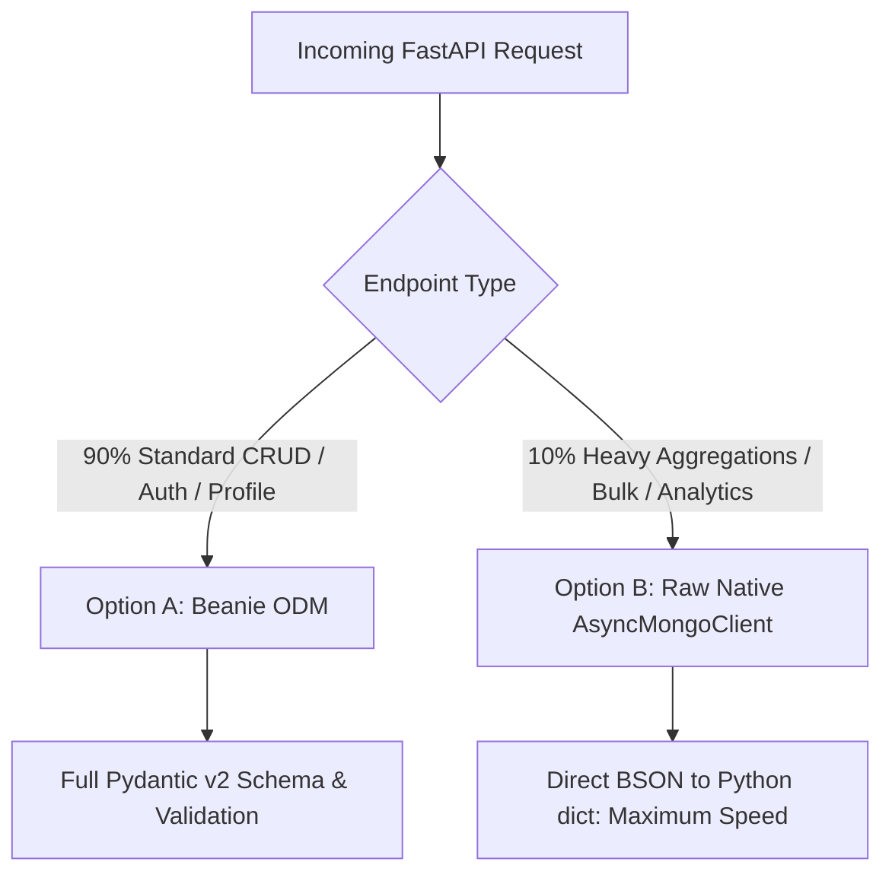
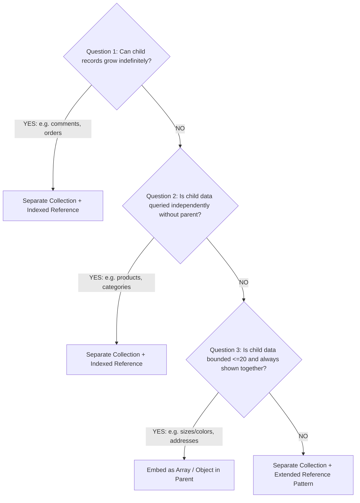

# Async MongoDB Production Architecture & Best Practices Guide
## (`docs/ASYNC_MONGODB_PRODUCTION_GUIDE.md`)

This document serves as the **definitive architectural guideline** for asynchronous MongoDB usage across this repository and all future backend systems derived from this starter backbone template.

---

## 1. Executive Summary: The Modern Async MongoDB Paradigm

For modern ASGI web frameworks like **FastAPI**, synchronous database drivers are strictly forbidden. While historically Python developers relied on `motor` for asynchronous MongoDB interaction, **MongoDB has officially introduced native asynchronous support (`AsyncMongoClient`) inside the core `pymongo` (v4.9+) library and announced a roadmap toward deprecating Motor**.



### Why Motor is Deprecated in Modern Architecture:
1. **Thread Pool Simulation**: Motor was essentially a wrapper that pushed synchronous PyMongo operations onto an underlying Python thread pool executor.
2. **Native Async Engine**: PyMongo v4.9+ was re-engineered with native asynchronous socket I/O, completely eliminating thread-switching overhead.
3. **Beanie 2.x Integration**: Beanie now supports and operates directly on `AsyncMongoClient`, offering maximum throughput with minimal resource consumption.

---

## 2. Sync vs Async MongoDB in FastAPI

| Feature / Metric | Synchronous PyMongo (`MongoClient`) | Native Asynchronous (`AsyncMongoClient` / Beanie) |
| :--- | :--- | :--- |
| **Execution Mechanics** | Blocks the current operating system thread until MongoDB responds. | Registers socket callback with asyncio event loop and yields execution (`await`). |
| **FastAPI Impact** | ❌ **CRITICAL HAZARD**: Calling synchronous queries inside `async def` freezes the **entire server event loop**. All concurrent users wait! | ✅ **Zero Blocking**: While the database processes query for User A, the CPU serves Users B, C, and D instantly. |
| **Concurrency (High RPS)** | Thread pool exhaustion causes request queueing, ballooning latency, and 504 Gateway Timeouts under load. | Handles **thousands of concurrent requests** per second using a single lightweight event loop process. |
| **Memory & CPU Footprint** | High memory due to dozens of heavy OS threads. | Substantially lower memory and CPU usage; cooperative multitasking. |
| **Target Use Cases** | CLI migration scripts, legacy Django/Flask (Sync), Celery workers. | **FastAPI, WebSockets, Real-time Chat, AI streaming, and High-Traffic Production APIs.** |

---

## 3. The 3 Async MongoDB Paradigms (Which One to Choose?)



---

### Option A: Beanie ODM (Best for Speed of Development & Clean Code)
Use Beanie for standard domain business logic, authentication, profile updates, and entity relationships.

* **Advantages**:
  - Automatic Pydantic v2 payload validation.
  - Transparent index management (`class Settings: indexes = [...]`).
  - Expressive object-oriented queries (`await User.find_one(User.email == email)`).
  - Built-in document lifecycle hooks (`@before_event`, `@after_event`).
* **Cost**:
  - Deserializing hundreds of BSON documents into Pydantic models incurs CPU parsing overhead.
* **Production Rule**:
  - For list endpoints, **always project fields** to avoid instantiating full heavy models:
    ```python
    users = await User.find(User.isActive == True).project(UserSummaryProjection).to_list()
    ```

---

### Option B: Native PyMongo Async (`AsyncMongoClient`) — Maximum Raw Speed
Use native PyMongo collections directly when performing large data transformations or high-throughput analytics.

```python
from pymongo import AsyncMongoClient

# Native Async Initialization (PyMongo 4.9+)
client = AsyncMongoClient("mongodb://localhost:27017")
db = client.my_database

async def fetch_user_raw(email: str) -> dict | None:
    return await db.users.find_one({"email": email})
```

* **Advantages**:
  - Zero ODM or Pydantic parsing overhead.
  - Returns raw Python dictionaries directly.
  - Highest possible requests-per-second (RPS) and lowest latency.
* **When to use**:
  - Complex `$lookup` / `$facet` aggregation pipelines.
  - Admin analytics dashboards with high aggregation intensity.
  - Bulk batch inserts (`insert_many`) or mass data migrations.

---

### Option C: The Hybrid Production Approach (The Industry Standard)
This template strictly enforces **The Hybrid Approach**:
* **90% of APIs (CRUD, Auth, Profile Update, Settings)**:
  Handled via **Beanie ODM** for safety, strict typing, and developer ergonomics.
* **10% of APIs (Analytics, Dashboards, Bulk Jobs, Search Aggregations)**:
  Handled via **`Model.get_pymongo_collection()`** directly inside service methods. This allows zero-cost access to the raw native asynchronous driver without losing Beanie's document configuration.

#### Hybrid Code Example:
```python
# 1. 90% Case: Clean Beanie CRUD
async def get_user_by_id(user_id: str) -> User | None:
    return await User.get(PydanticObjectId(user_id))

# 2. 10% Case: High-Performance Raw Aggregation (Zero Pydantic Overhead)
async def get_active_users_aggregate(start_date: datetime) -> list[dict]:
    cursor = await User.get_pymongo_collection().aggregate([
        {"$match": {"createdAt": {"$gte": start_date}, "isDeleted": {"$ne": True}}},
        {"$group": {"_id": "$role", "count": {"$sum": 1}}},
        {"$sort": {"count": -1}}
    ])
    return await cursor.to_list(length=100)
```

---

## 4. MongoDB Relationships: Embedding vs Referencing (Why 100% Relations Exist in NoSQL)

In production software engineering, **MongoDB is 100% capable of handling relationships**, and nearly every production backend requires them. The misconception that NoSQL means "no relationships and embed everything in one document" leads to catastrophic production failures.

### 4.1 Why Relationships are Mandatory in MongoDB (The 3 Disasters of Blind Embedding)
If you embed unbounded arrays (e.g., `orders: [...]`, `comments: [...]`) inside a single `User` or `Post` document, you encounter 3 critical production traps:

1. **The 16MB Document Limit (`BSONObjectTooLarge` Crash)**:
   MongoDB strictly enforces a **16MB maximum document size**. An active user accumulating 5,000 orders or a viral post with 10,000 comments will breach this limit, throwing unrecoverable database write errors and crashing user workflows.
2. **RAM & CPU Exhaustion**:
   Calling `User.find_one()` simply to display a username pulls all 5,000 embedded orders into server memory, exhausting database cache and ASGI worker RAM.
3. **Update Anomalies (Massive Redundant Updates)**:
   If a shared entity (e.g., Category "Electronics" renamed to "Gadgets") is copied directly into 1,000,000 product documents instead of referenced, you must run 1,000,000 disk writes across the cluster.

> **Decision Rule**:
> - **Embed**: Bounded, tightly-coupled data with a fixed maximum size (e.g., 2-3 shipping addresses, 3-4 order line items).
> - **Reference (Relate)**: Growing (unbounded), shared, or heavily queried independent entities (e.g., Orders, Comments, Products, Audit Logs).

---

### 4.2 The 4 Professional Ways to Model Relationships in MongoDB

| Relationship Type | Best Industry Practice | When to Use? | Real-World Production Example |
| :--- | :--- | :--- | :--- |
| **1. One-to-Few** | **Embedding** (Array / Embedded Object) | Child data will never exceed 10–20 items; always queried together with parent. | User's `shipping_addresses` (Home, Work), Order's line `items` (2–5 items). |
| **2. One-to-Many** | **Child Referencing** (Parent `ObjectId` in Child) | Child data is unbounded (grows continuously) and requires independent pagination/filtering. | User's thousands of `Orders`, Post's thousands of `Comments`. |
| **3. Many-to-Many** | **Junction Collection / Array of ObjectIds** | Both sides associate with multiple records independently. | `Students` & `Courses`, Products & `Tags`. |
| **4. High-Speed Relation** | **Hybrid Extended Reference Pattern** (Indexed `ObjectId` + Embedded Summary) | Relationship is required, but reads must be instant (1-2ms) without running join / `$lookup`. | Orders embedding `{ userId, name, phone }` alongside indexed `userId`. |

---

### 4.3 Production Beanie ODM Implementation: The Hybrid Extended Reference Pattern
Senior architects avoid naive `Link[User]` in Beanie and instead implement **Indexed `PydanticObjectId` + Lightweight Summary Schema**:

```python
from datetime import datetime, timezone
from typing import Annotated, Optional
from beanie import Document, Indexed, PydanticObjectId
from pydantic import BaseModel, Field

# 1. Parent Collection: User
class User(Document):
    name: str
    email: Annotated[str, Indexed(unique=True)]
    avatar_url: Optional[str] = None

    class Settings:
        name = "users"


# 2. Lightweight Embedded Summary Schema (Prevents repetitive User joins)
class AuthorSummary(BaseModel):
    id: PydanticObjectId
    name: str
    avatar_url: Optional[str] = None


# 3. Child Collection: Post (One-to-Many with User)
class Post(Document):
    title: str
    content: str
    
    # A) Real Relation: Indexed Foreign Key for blazing fast filtering
    author_id: Annotated[PydanticObjectId, Indexed()]
    
    # B) Extended Snapshot: Embedded for zero-join ultra-fast feed reads
    author: AuthorSummary
    
    createdAt: datetime = Field(default_factory=lambda: datetime.now(timezone.utc))

    class Settings:
        name = "posts"
```

#### Why This Hybrid Pattern Excels in Production:
- **Zero-Join Feed Loading (0.5ms)**:
  `await Post.find_all().limit(20).to_list()` immediately yields the post along with `post.author.name` and `post.author.avatar_url` in **one single indexed read** with zero joins or lookups!
- **Indexed Filter for User Posts (1ms)**:
  `await Post.find(Post.author_id == user.id).to_list()` hits the index on `author_id` instantly via `IXSCAN`.
- **Full Profile on Demand**:
  When full profile details (phone, settings, addresses) are explicitly requested, execute `await User.get(post.author_id)` directly on the primary index.

---

### 4.4 Litmus Test: When to Embed vs When to Reference? (3 Gold Standard Questions)



1. **Question 1: Can the child data grow indefinitely over time?**
   - *If YES* (e.g., comments, logs, orders, notifications): **Always create a separate collection with an indexed `ObjectId` reference**. Never embed unbounded arrays.
2. **Question 2: Does the child data exist or get queried independently from the parent?**
   - *If YES* (e.g., products belonging to categories, authors writing articles): **Always create a separate collection with an indexed reference**.
3. **Question 3: Is the child data bounded (2–10 items) and always accessed with the parent?**
   - *If YES* (e.g., product color/size variants, user shipping addresses): **Embed inside the parent document as an array or sub-object**.

---

## 5. The Population & Join Trap: 4 Beast Mode Techniques for 1-5ms Relational Data Retrieval

In Node.js/Mongoose it's called `.populate()`, in MongoDB Core Engine it's `$lookup` (Aggregation Join), and in Python Beanie ODM it's `Link[...]` + `fetch_links=True`.

> [!CAUTION]
> **The Naive Population Trap**:
> Blindly using `fetch_links=True` or unconstrained `$lookup` makes MongoDB **10x slower** in production!
> - When running `await Order.find(fetch_links=True).to_list()`, Beanie performs a full multi-document `$lookup` pulling **entire linked documents** (password hashes, settings, tokens, large embedded logs) when all you needed was just `name` and `avatar`!
> - Deep/nested relations (e.g., `Order -> User -> Company`) trigger multiple sequential joins, exhausting database RAM and CPU.

Below are the **4 Industry-Standard Beast Mode Techniques** to retrieve relational data in **1 to 5 milliseconds**:

---

### Technique 1: Production-Grade Pipeline Population (`$lookup` with Sub-Pipeline & Projection)
When two collections genuinely need to be joined, never pull the full document. Use `$lookup` with a nested `pipeline` and strict `$project`.


#### Production Code Example (FastAPI + Beanie):
```python
from bson import ObjectId
from pydantic import BaseModel

# 1. Lightweight response models: zero unused fields
class PopulatedUser(BaseModel):
    name: str
    email: str

class OrderWithUserResponse(BaseModel):
    id: str
    total_amount: float
    status: str
    user: PopulatedUser  # Only required fields are populated!

# 2. Ultra-Fast Aggregation Pipeline
async def get_orders_fast(limit: int = 20) -> list[OrderWithUserResponse]:
    pipeline = [
        # Step A: Filter, sort and LIMIT FIRST (Crucial: never join millions of rows!)
        {"$match": {"status": "completed"}},
        {"$sort": {"createdAt": -1}},
        {"$limit": limit},

        # Step B: Optimized Population ($lookup with sub-pipeline)
        {
            "$lookup": {
                "from": "users",              # Target collection
                "localField": "userId",       # Foreign Key ObjectId
                "foreignField": "_id",        # Primary Key (strictly indexed)
                "as": "user_info",
                "pipeline": [
                    # Pull ONLY name and email; never pull passwords or heavy objects!
                    {"$project": {"_id": 0, "name": 1, "email": 1}}
                ],
            }
        },

        # Step C: Convert array to single object ($unwind)
        {"$unwind": {"path": "$user_info", "preserveNullAndEmptyArrays": True}},

        # Step D: Final clean projection
        {
            "$project": {
                "id": {"$toString": "$_id"},
                "total_amount": 1,
                "status": 1,
                "user": "$user_info",
            }
        },
    ]

    # Directly deserialize into Pydantic Projection Model
    return await Order.aggregate(
        pipeline, projection_model=OrderWithUserResponse
    ).to_list()
```
* **Why this is 10x faster**:
  Because `$match` and `$limit: 20` execute **first**, MongoDB only looks up users for exactly 20 orders, reading only 2 fields into memory instead of scanning millions of records.

---

### Technique 2: Application-Level Batch Population (`$in` Query — The Mongoose Pattern)
For many endpoints, executing two separate primary index queries in Python is even faster than a database `$lookup` join (this is how Mongoose `.populate()` works under the hood):

```python
from beanie.operators import In

async def get_orders_batch_populate() -> list[dict]:
    # Query 1: Fetch 20 orders using IXSCAN (1ms)
    orders = await Order.find(Order.status == "completed").limit(20).to_list()
    
    # Extract unique user_ids into a set
    user_ids = list({order.userId for order in orders if order.userId})
    
    # Query 2: Single $in query hitting Primary Index _id (1ms)
    users = await User.find(In(User.id, user_ids)).project(UserShortView).to_list()
    user_map = {u.id: u for u in users}
    
    # Map in Python memory in 0.01ms (Zero Database Join CPU load!)
    return [
        {**order.model_dump(), "user": user_map.get(order.userId)}
        for order in orders
    ]
```
* **Why this excels**:
  Both queries hit primary indexes (`_id`), eliminating all join locking and CPU overhead on the MongoDB database server.

---

### Technique 3: The Ultimate Speed Hack — Extended Reference Pattern (Zero-Join Architecture)
In true hyper-scale production (e.g., 10,000+ requests/sec), **no joins or `$lookup` queries are executed at all**. Instead, use the **Extended Reference Pattern (Denormalization)**.

#### How It Works:
When saving an order or chat message, embed the 2-3 fields that the frontend always displays directly inside the document:

```json
{
  "_id": "order_999",
  "totalAmount": 1500,
  "status": "completed",
  "buyer": {
    "userId": "user_123",
    "name": "Sourav",
    "avatar": "https://res.cloudinary.com/.../avatar.webp"
  },
  "createdAt": "2026-10-24T22:45:00Z"
}
```

* **The Benefit**: A single query retrieves the entire page in **0.5 milliseconds** with zero joins!
* **Handling Updates**: When a user updates their name or avatar, dispatch a background task via `fire_and_forget` to update recent records asynchronously.

---

### Technique 4: The 4 Master Tricks for 100% Blazing Fast Data Retrieval

1. **Mandatory Foreign Field Indexing**:
   Every field participating in a join or relationship (`userId`, `orderId`, `chatId`) **must** have an explicit index in `Settings.indexes`. Without this, every `$lookup` triggers a catastrophic full collection scan (`COLLSCAN`).
2. **Covered Queries (RAM-Only Read — 0 Disk I/O)**:
   If all fields in your `$match`, `$sort`, and `$project` are included in a Compound Index, MongoDB returns the data directly from RAM without touching the physical storage disk!
   ```python
   # Covered index: Zero disk read!
   pymongo.IndexModel([("userId", 1), ("status", 1), ("amount", 1)])
   ```
3. **Single-Call Dashboard (`$facet`)**:
   Never make 3 to 5 separate database round-trips to populate an admin dashboard. Use a single `$facet` pipeline to compute total revenue, pending counts, and latest transactions in **one single database round-trip**:
   ```python
   pipeline = [
       {
           "$facet": {
               "totalOrders": [{"$count": "count"}],
               "pendingOrders": [
                   {"$match": {"status": "pending"}},
                   {"$count": "count"},
               ],
               "recentOrders": [
                   {"$sort": {"createdAt": -1}},
                   {"$limit": 5},
                   {"$project": {"amount": 1, "status": 1}},
               ],
           }
       }
   ]
   ```
4. **Cursor-Based Keyset Pagination (Never use deep `.skip()`):**
   When paginating thousands of records, `skip(10000).limit(20)` forces MongoDB to scan and discard 10,000 documents. Keyset pagination using `_id: {"$lt": last_seen_id}` executes in **1 millisecond** regardless of whether you are on page 1 or page 50,000.

---

## 6. Alternative Architectures: When to Pick PostgreSQL vs MongoDB?

| Architectural Criterion | MongoDB (Async Beanie + PyMongo) | PostgreSQL (Async SQLAlchemy 2.0 + asyncpg) |
| :--- | :--- | :--- |
| **Schema Flexibility** | Dynamic, polymorphic documents; ideal for rapid pivots and evolving JSON structures. | Strict tabular relational schema with explicit migrations (Alembic). |
| **Query Strengths** | Nested documents, embedded arrays, geospatial coordinates, high-volume append logs, chats. | Complex multi-table relational joins, recursive CTEs, full-text window functions. |
| **Financial / Ledger Data** | Multi-document transactions supported, but requires careful replica set coordination. | **The Industry Gold Standard**: Strict ACID, foreign key integrity, double-entry ledgers, banking/wallets. |
| **Vertical / Horizontal Scale**| Effortless horizontal sharding and replica set auto-failover. | Superior vertical scaling, read-replicas, partitioning. |

> **Architecture Verdict**: 
> For **SaaS, real-time communication (Socket.IO), content platforms, mobile backends, and multi-tenant applications**, MongoDB with the Async Hybrid Approach is the optimal choice. For **strict banking, ledger accounting, and compliance-heavy fintech platforms**, Async PostgreSQL with `asyncpg` is recommended.

---

## 7. The 6 Golden Rules for Production Async MongoDB

1. **NEVER use blocking `MongoClient` inside `async def`**:
   Importing `from pymongo import MongoClient` inside FastAPI routes will freeze the ASGI worker. Always use `from pymongo import AsyncMongoClient` or `Beanie.Document`.
2. **Never embed unbounded growing arrays (The 16MB Rule)**:
   Never store unbounded items (orders, comments, logs, notifications) as arrays inside a parent document. Always use child referencing with `author_id: Annotated[PydanticObjectId, Indexed()]` or the Extended Reference Pattern.
3. **Always enforce connection pooling limits**:
   Always set `minPoolSize=10`, `maxPoolSize=100`, and `maxIdleTimeMS=30000` to prevent socket starvation under sudden traffic bursts.
4. **Mandatory Indexing (IXSCAN vs COLLSCAN)**:
   Every queried field (`find`, `sort`, `$match`) and foreign key reference (`authId`, `userId`, `author_id`) must be defined in `class Settings: indexes = [...]`.
5. **Zero N+1 Async Loops**:
   Never run `await Model.find_one(...)` inside a `for` loop. Use `{"$in": id_list}` or `asyncio.gather` for concurrent parallel fetching.
6. **Keyset Pagination over Deep `skip()`**:
   For collections with over 10,000 documents, paginate using `_id: {"$gt": last_id}` or `createdAt: {"$lt": last_timestamp}` instead of expensive `.skip(N)`.

---

## 8. Official Implementation Reference

- Database Connection Initialization: [src/connection/connect_db.py](file:///c:/Users/Sourav/Documents/Start/src/connection/connect_db.py)
- High-Performance Query & Indexing Patterns: [docs/MONGODB_PERFORMANCE.md](file:///c:/Users/Sourav/Documents/Start/docs/MONGODB_PERFORMANCE.md)
- Complete MongoDB Collection Catalog: [docs/DATABASE_SCHEMA.md](file:///c:/Users/Sourav/Documents/Start/docs/DATABASE_SCHEMA.md)

