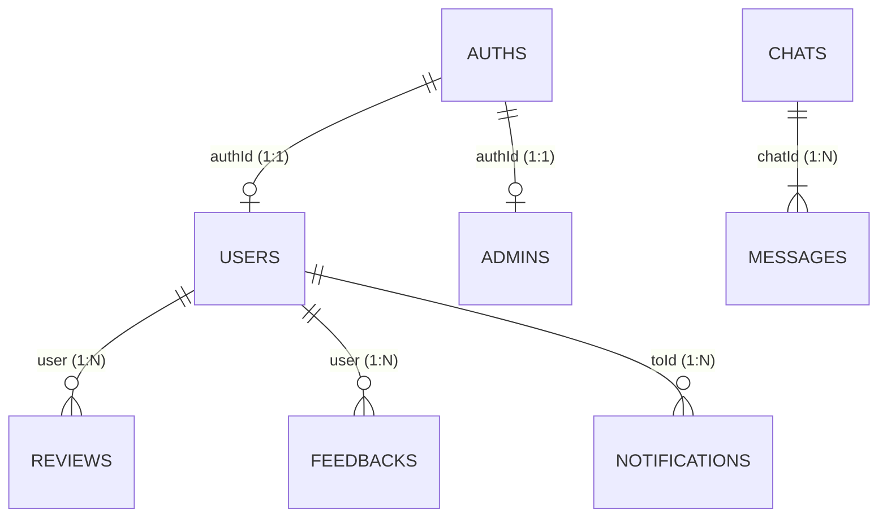

# Database Schema Catalog (`docs/DATABASE_SCHEMA.md`)

This document is the **official, authoritative reference** for all MongoDB database collections, document models, fields, data types, indexes, and relationships in the application.

> [!IMPORTANT]
> **Mandatory Agent Rule**: Whenever adding, modifying, or removing any collection, field, data type, or index in the backend codebase, the agent or engineer **MUST** immediately update this document to keep the schema catalog 100% in sync with the source code.

---

## 1. Global Document Conventions

All models (except embedded sub-documents) inherit from `TimestampedDocument` ([src/util/base_document.py](file:///c:/Users/Sourav/Documents/Start/src/util/base_document.py)), which automatically manages MongoDB `_id` and UTC timestamps:

| Field | BSON Type | Python Type | Default | Description |
| :--- | :--- | :--- | :--- | :--- |
| `_id` | `ObjectId` | `PydanticObjectId` | Auto (`ObjectId()`) | Primary Key unique identifier |
| `createdAt` | `Date` | `datetime` | `utcnow()` | UTC document creation timestamp |
| `updatedAt` | `Date` | `datetime` | `utcnow()` | UTC timestamp updated on every save/mutation |

---

## 2. Collections & Document Models

---

### 2.1 `auths` (Auth Model)
- **Source**: [src/app/module/auth/auth_model.py](file:///c:/Users/Sourav/Documents/Start/src/app/module/auth/auth_model.py)
- **Purpose**: Stores core authentication credentials, role assignments, account statuses, activation/recovery OTPs, and OAuth identifiers.
- **Security Projection**: `password` is strictly omitted from all public responses (`AUTH_PUBLIC_PROJECTION = {"password": 0}`).

#### Fields
| Field | BSON Type | Python Type | Required | Default | Validation / Notes |
| :--- | :--- | :--- | :--- | :--- | :--- |
| `name` | `string` | `str` | Yes | - | Full name of the account holder |
| `email` | `string` | `str` | Yes | - | Validated email regex, lowercase |
| `password` | `string` | `str` | Yes | - | Bcrypt hashed password (empty for pure OAuth accounts) |
| `role` | `string` | `str` | Yes | - | `USER`, `ADMIN`, `SUPER_ADMIN`, `DRIVER` |
| `isVerified` | `bool` | `bool \| None` | No | `None` | Email verification flag |
| `isBlocked` | `bool` | `bool \| None` | No | `False` | Administrative account ban flag |
| `isActive` | `bool` | `bool \| None` | No | `False` | Account active state |
| `isDeleted` | `bool` | `bool \| None` | No | `False` | Soft-delete flag (30-day retention) |
| `deletedAt` | `Date` | `datetime \| None`| No | `None` | Soft-deletion initiation timestamp |
| `googleId` | `string` | `str \| None` | No | `None` | Google OAuth subject identifier (`sub`) |
| `appleId` | `string` | `str \| None` | No | `None` | Apple Sign-In subject identifier (`sub`) |
| `verificationCode` | `string` | `str \| None` | No | `None` | Password reset OTP hash |
| `verificationCodeExpire` | `Date` | `datetime \| None` | No | `None` | Reset OTP expiration |
| `verificationAttempts` | `int` | `int \| None` | No | `0` | Rate limiter count for reset OTP |
| `activationCode` | `string` | `str \| None` | No | `None` | Registration activation OTP |
| `activationCodeExpire` | `Date` | `datetime \| None` | No | `None` | Activation OTP expiration |
| `activationAttempts` | `int` | `int \| None` | No | `0` | Rate limiter count for activation OTP |

#### Indexes
| Index Keys | Type | Options | Purpose |
| :--- | :--- | :--- | :--- |
| `[("email", 1)]` | Single field | `unique=True` | Unique login and registration lookups |
| `[("isDeleted", 1), ("deletedAt", 1)]` | Compound | Default | Superfast IXSCAN for soft-delete queries & retention cleanup |
| `[("googleId", 1)]` | Single field | `sparse=True` | OAuth Google Sign-In lookup |
| `[("appleId", 1)]` | Single field | `sparse=True` | OAuth Apple Sign-In lookup |

---

### 2.2 `users` (User Model)
- **Source**: [src/app/module/user/user_model.py](file:///c:/Users/Sourav/Documents/Start/src/app/module/user/user_model.py)
- **Purpose**: User profile information, contact numbers, address, and live geospatial coordinates.

#### Fields
| Field | BSON Type | Python Type | Required | Default | Notes |
| :--- | :--- | :--- | :--- | :--- | :--- |
| `authId` | `ObjectId` | `PydanticObjectId` | Yes | - | Foreign Key -> `auths._id` |
| `name` | `string` | `str` | Yes | - | User display name |
| `email` | `string` | `str` | Yes | - | User email |
| `profile_image` | `string` | `str \| None` | No | `None` | Uploaded image path or OAuth avatar URL |
| `phoneNumber` | `string` | `str \| None` | No | `None` | Contact phone number |
| `dateOfBirth` | `string` | `str \| None` | No | `None` | User date of birth string |
| `address` | `string` | `str \| None` | No | `None` | Physical residential address |
| `isOnline` | `bool` | `bool \| None` | No | `False` | Real-time Socket.IO presence status |
| `isDeleted` | `bool` | `bool \| None` | No | `False` | Synced soft-delete flag |
| `deletedAt` | `Date` | `datetime \| None`| No | `None` | Synced soft-delete timestamp |
| `locationCoordinates`| `object` | `LocationCoordinates` | No | `None` | GeoJSON `{ type: "Point", coordinates: [lng, lat] }` |

#### Indexes
| Index Keys | Type | Purpose |
| :--- | :--- | :--- |
| `[("authId", 1)]` | Single field | 1-to-1 lookup from `Auth` session |
| `[("email", 1)]` | Single field | Fast lookup and search |
| `[("isDeleted", 1), ("deletedAt", 1)]` | Compound | Cleanup job filtering |
| `[("locationCoordinates", "2dsphere")]` | Geospatial | `$nearSphere` / geospatial distance queries |

---

### 2.3 `admins` (Admin Model)
- **Source**: [src/app/module/admin/admin_model.py](file:///c:/Users/Sourav/Documents/Start/src/app/module/admin/admin_model.py)
- **Purpose**: Admin and Super Admin profile metadata.

#### Fields
| Field | BSON Type | Python Type | Required | Default | Notes |
| :--- | :--- | :--- | :--- | :--- | :--- |
| `authId` | `ObjectId` | `PydanticObjectId` | Yes | - | Foreign Key -> `auths._id` |
| `name` | `string` | `str` | Yes | - | Admin name |
| `email` | `string` | `str` | Yes | - | Admin email |
| `profile_image` | `string` | `str \| None` | No | `None` | Admin avatar path |
| `phoneNumber` | `string` | `str \| None` | No | `None` | Phone number |
| `address` | `string` | `str \| None` | No | `None` | Address |
| `isDeleted` | `bool` | `bool \| None` | No | `False` | Soft delete flag |
| `deletedAt` | `Date` | `datetime \| None`| No | `None` | Soft delete timestamp |

#### Indexes
| Index Keys | Type | Purpose |
| :--- | :--- | :--- |
| `[("authId", 1)]` | Single field | Fast 1-to-1 relation lookup |
| `[("email", 1)]` | Single field | Email search |
| `[("isDeleted", 1), ("deletedAt", 1)]` | Compound | Soft-delete IXSCAN |

---

### 2.4 `chats` (Chat Model)
- **Source**: [src/app/module/chat/chat_model.py](file:///c:/Users/Sourav/Documents/Start/src/app/module/chat/chat_model.py)
- **Purpose**: Chat room metadata between two or more participants.

#### Fields
| Field | BSON Type | Python Type | Required | Default | Notes |
| :--- | :--- | :--- | :--- | :--- | :--- |
| `participants` | `Array[ObjectId]` | `list[PydanticObjectId]` | Yes | `[]` | List of `users._id` in this conversation |

#### Indexes
| Index Keys | Type | Purpose |
| :--- | :--- | :--- |
| `[("participants", 1)]` | Multikey | Finding chats involving a specific user |

---

### 2.5 `messages` (Message Model)
- **Source**: [src/app/module/chat/message_model.py](file:///c:/Users/Sourav/Documents/Start/src/app/module/chat/message_model.py)
- **Purpose**: Individual chat messages. Separated from `chats` to prevent the 16MB document cap limit.

#### Fields
| Field | BSON Type | Python Type | Required | Default | Notes |
| :--- | :--- | :--- | :--- | :--- | :--- |
| `chatId` | `ObjectId` | `PydanticObjectId` | Yes | - | Foreign Key -> `chats._id` |
| `sender` | `ObjectId` | `PydanticObjectId` | Yes | - | Foreign Key -> `users._id` |
| `receiver` | `ObjectId` | `PydanticObjectId` | Yes | - | Foreign Key -> `users._id` |
| `message` | `string` | `str` | Yes | - | Message text content |
| `isRead` | `bool` | `bool` | Yes | `False` | Message read status |

#### Indexes
| Index Keys | Type | Purpose |
| :--- | :--- | :--- |
| `[("chatId", 1), ("createdAt", -1)]` | Compound | Fast paginated chat history (newest first) |
| `[("receiver", 1), ("isRead", 1)]` | Compound | Fast count of unread messages per user |

---

### 2.6 `notifications` (Notification Model)
- **Source**: [src/app/module/notification/notification_model.py](file:///c:/Users/Sourav/Documents/Start/src/app/module/notification/notification_model.py)
- **Purpose**: In-app notifications for end users.

#### Fields
| Field | BSON Type | Python Type | Required | Default | Notes |
| :--- | :--- | :--- | :--- | :--- | :--- |
| `toId` | `ObjectId` | `PydanticObjectId` | Yes | - | Foreign Key -> `users._id` |
| `title` | `string` | `str` | Yes | - | Notification title |
| `message` | `string` | `str` | Yes | - | Notification body |
| `isRead` | `bool` | `bool` | Yes | `False` | Read status |

#### Indexes
| Index Keys | Type | Purpose |
| :--- | :--- | :--- |
| `[("toId", 1), ("isRead", 1)]` | Compound | Fast unread notifications filter |

---

### 2.7 `adminnotifications` (AdminNotification Model)
- **Source**: [src/app/module/notification/admin_notification_model.py](file:///c:/Users/Sourav/Documents/Start/src/app/module/notification/admin_notification_model.py)
- **Purpose**: Global system alerts and administrator notifications.

#### Fields
| Field | BSON Type | Python Type | Required | Default | Notes |
| :--- | :--- | :--- | :--- | :--- | :--- |
| `title` | `string` | `str` | Yes | - | Alert title |
| `message` | `string` | `str` | Yes | - | Alert message |
| `isRead` | `bool` | `bool` | Yes | `False` | Read status |

---

### 2.8 `feedbacks` (Feedback Model)
- **Source**: [src/app/module/feedback/feedback_model.py](file:///c:/Users/Sourav/Documents/Start/src/app/module/feedback/feedback_model.py)
- **Purpose**: User customer feedback submissions and admin responses.

#### Fields
| Field | BSON Type | Python Type | Required | Default | Notes |
| :--- | :--- | :--- | :--- | :--- | :--- |
| `user` | `ObjectId` | `PydanticObjectId \| None` | No | `None` | Optional FK -> `users._id` |
| `name` | `string` | `str` | Yes | - | Submitter name |
| `email` | `string` | `str` | Yes | - | Submitter email |
| `feedback`| `string` | `str` | Yes | - | Feedback message |
| `reply` | `string` | `str \| None` | No | `None` | Admin response text |

---

### 2.9 `reviews` (Review Model)
- **Source**: [src/app/module/review/review_model.py](file:///c:/Users/Sourav/Documents/Start/src/app/module/review/review_model.py)
- **Purpose**: User reviews and ratings (1 to 5).

#### Fields
| Field | BSON Type | Python Type | Required | Default | Constraints |
| :--- | :--- | :--- | :--- | :--- | :--- |
| `user` | `ObjectId` | `PydanticObjectId` | Yes | - | FK -> `users._id` |
| `rating` | `int` | `int` | Yes | - | Constrained between 1 and 5 (`ge=1, le=5`) |
| `review` | `string` | `str` | Yes | - | Written review |

---

### 2.10 Static Content Management Collections (`manage_model.py`)
- **Source**: [src/app/module/manage/manage_model.py](file:///c:/Users/Sourav/Documents/Start/src/app/module/manage/manage_model.py)
- All inherit from `_Description(TimestampedDocument)` containing a single `description: str` field.

| Collection Name | Document Model | Description |
| :--- | :--- | :--- |
| `termsconditions` | `TermsConditions` | Platform terms & conditions |
| `privacypolicies` | `PrivacyPolicy` | Platform privacy policies |
| `faqs` | `FAQ` | Frequently asked questions |
| `aboutus` | `AboutUs` | About Us information |
| `contactus` | `ContactUs` | Support contact details |
