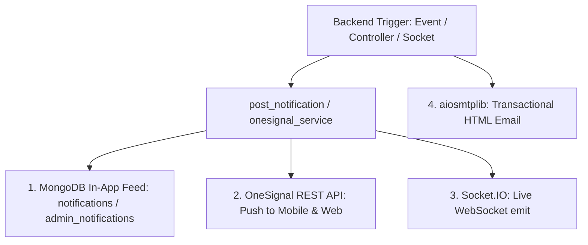

# Backend Notification Catalog & OneSignal Architecture (docs/NOTIFICATIONS.md)

This document is the **single source of truth** for all notifications generated by this backend. Whenever any developer or AI agent adds or modifies a notification, it **must** be cataloged in this file.

---

## 1. Notification Architecture & Channels

This backend employs a hybrid multi-channel notification architecture:



1. **In-App Notification Feed**: Persisted in MongoDB (`notifications` collection for users, `admin_notifications` for system-wide alerts).
2. **OneSignal Push Notifications**: Sent to mobile (iOS / Android) and Web push subscribers via OneSignal's official REST API (`POST https://api.onesignal.com/notifications`).
3. **Real-Time WebSockets**: Live instant updates to active sessions via `python-socketio`.
4. **Transactional Email**: Critical OTPs, account activation, and password resets via `aiosmtplib`.

---

## 2. OneSignal Integration & Frontend Mapping

### A. Environment Configuration (`.env`)
```bash
#------------ONESIGNAL---------------------------------
ONESIGNAL_APP_ID=your_onesignal_app_id
ONESIGNAL_REST_API_KEY=your_onesignal_rest_api_key
```

### B. Client-to-Backend Identification (`external_id`)
To ensure push notifications reach the specific user:
- On Frontend login (Mobile / Web SDK):
  ```javascript
  // After successful sign-in or activation:
  OneSignal.login(userId); // userId is the MongoDB User "_id" or "authId"
  ```
- On Backend push dispatch:
  The backend targets the user via `include_aliases: {"external_id": [user_id]}`. OneSignal automatically routes the push notification to all devices registered by that user!

---

## 3. Active Notification Catalog (ব্যাকএন্ড নোটিফিকেশন ক্যাটালগ)

| Event Identifier | Trigger Condition | Delivery Channels | Target Recipient | Title & Content Template | Custom `data` Payload |
|---|---|---|---|---|---|
| `CHAT_NEW_MESSAGE` | When a user sends a 1-to-1 chat message via Socket.IO | 📱 OneSignal Push<br>🔔 In-App Feed<br>⚡ Socket.IO | Receiver (`external_id: receiver_id`) | **Title**: `New message`<br>**Message**: `<Message snippet>` | `{"type": "chat", "senderId": "..."}` |
| `AUTH_WELCOME` | Upon successful account activation (`/activate-account`) | 📱 OneSignal Push<br>🔔 In-App Feed | User (`external_id: user_id`) | **Title**: `Welcome to Mount Fuji!`<br>**Message**: `Your account has been verified successfully.` | `{"type": "account", "action": "welcome"}` |
| `AUTH_ACTIVATION_OTP` | Upon user registration (`/sign-up`) or resend (`/resend-otp`) | ✉️ Transactional Email | Registered Email | **Subject**: `Activation Code`<br>**Content**: 6-digit OTP code | N/A (Email) |
| `AUTH_RESET_PASSWORD_OTP` | When user requests password reset (`/forgot-password`) | ✉️ Transactional Email | Account Email | **Subject**: `Password Reset Code`<br>**Content**: 6-digit OTP code | N/A (Email) |
| `AUTH_PASSWORD_CHANGED` | Upon successful password modification (`/change-password`) | 📱 OneSignal Push<br>🔔 In-App Feed | User (`external_id: user_id`) | **Title**: `Security Alert`<br>**Message**: `Your account password was recently changed.` | `{"type": "security", "action": "password_changed"}` |
| `AUTH_NEW_DEVICE_LOGIN` | When sign-in is detected from a new/unrecognized device | ✉️ Transactional Email<br>📱 OneSignal Push<br>🔔 In-App Feed | User (`external_id: user_id` / Email) | **Subject / Title**: `Security Alert: New Sign-in`<br>**Content**: Device name, client IP & UTC timestamp | `{"type": "security", "action": "new_device_login"}` |
| `ADMIN_SYSTEM_ALERT` | System-level broadcast or administrative notice | 📱 OneSignal Push (Segment)<br>🔔 Admin In-App Feed | All Subscribed Users / Admins | **Title**: `<Alert Title>`<br>**Message**: `<Alert Body>` | `{"type": "system_announcement"}` |

---

## 4. How to Send Notifications from Backend Code

### Option 1: Universal Helper (`post_notification`)
Saves to MongoDB In-App feed **AND** dispatches OneSignal Push simultaneously:
```python
from src.util.post_notification import post_notification

# Send to a specific user (In-app + OneSignal Push)
await post_notification(
    title="Order Shipped",
    message="Your order #12345 is on its way!",
    to_id=str(user_id),
    data={"orderId": "12345", "type": "order_update"},
)

# Send to Admins (In-app Admin Feed)
await post_notification(
    title="New User Registered",
    message="John Doe just registered an account.",
    to_id=None,
)
```

### Option 2: Direct OneSignal Push (`send_onesignal_notification`)
For advanced targeting (Segments, Subscription IDs, Custom URL):
```python
from src.util.onesignal import send_onesignal_notification
from src.util.fire_and_forget import fire_and_forget

# Non-blocking segment broadcast (e.g. promotional announcement)
fire_and_forget(
    send_onesignal_notification(
        title="Weekend Special Offer! 🎉",
        message="Get 20% off on all services this weekend.",
        segments=["Subscribed Users"],
        data={"promoCode": "WEEKEND20"},
        url="https://app.com/promos",
    )
)
```

---

## 5. Mandatory Agent Protocol (এজেন্টের জন্য অবশ্য পালনীয় নিয়ম)

> [!IMPORTANT]
> Whenever any AI agent (Antigravity / Gemini) creates a new module, endpoint, or background job that dispatches notifications, the agent **MUST**:
> 1. Register the notification in the table above under **Section 3**.
> 2. Document the Event Identifier, Trigger Condition, Target Audience, Channels, and Payload.
> 3. Ensure non-blocking execution using `fire_and_forget` or `asyncio.create_task`.
