# Redis Production Architecture & 10 Golden Rules (`docs/REDIS_GUIDELINES.md`)

This document is the **official, authoritative reference and architectural standard** for Redis usage across this backend repository. All contributors and AI agents **MUST strictly adhere** to these 10 Golden Rules. Any violation detected will fail the automated build verification (`scripts/verify_standards.py`).

---

## The 10 Golden Rules for Redis in Production

```mermaid
flowchart TD
    subgraph 1. Memory & Lifespan
        TTL[1. Never SET without TTL] --> MaxMem[maxmemory 256mb]
        MaxMem --> Eviction[volatile-ttl eviction]
    end

    subgraph 2. Network & Performance
        Pool[2. Global Connection Pool] --> Timeout[socket_timeout = 2.0s]
        Timeout --> NonBlocking[4. Zero-Blocking: UNLINK & SCAN]
        NonBlocking --> Pipeline[7. Multi-key Pipelining]
    end

    subgraph 3. Resilience & Defense
        Stampede[6. Mutex Lock - SETNX] --> Avalanche[TTL Jitter]
        Avalanche --> Penetration[Null Caching]
        Penetration --> FailOpen[3. Fail-Open Auth Fallback]
    end

    subgraph 4. Consistency & Security
        RDB_AOF[5. Hybrid RDB + AOF] --> Namespace[8. Strict Namespaces]
        Namespace --> Hardening[9. Private Network Only]
        Hardening --> Lifespan[10. Clean FastAPI Lifespan]
    end
```



---

### Rule 1: Memory Management & Mandatory TTL
- **Never Set Keys Without TTL**: Every key must have an expiration. Never call `SET` without `ex=` or use `setex`. Without TTL, RAM fills up and the process crashes with Out Of Memory (OOM).
- **Eviction Policy**: Set to `volatile-ttl` in `docker/redis/redis.conf`. Only keys with an explicit TTL that are closest to expiring are evicted when memory reaches `maxmemory`.

### Rule 2: Connection Pooling & Socket Timeouts
- **Never open a new TCP connection per request**. Always reuse the shared async connection pool in `src.connection.connect_redis`.
- **Mandatory Socket Timeouts**:
  - `socket_timeout=2.0` (prevents hanging worker threads if Redis freezes)
  - `socket_connect_timeout=2.0`
  - `health_check_interval=30`

### Rule 3: Graceful Degradation (Fail-Open Auth)
- If the Redis server restarts or is temporarily unreachable:
  - **Auth Middleware**: Operates in **Fail-Open** mode with local in-memory fallback. Valid JWT signatures are verified by the CPU, logging a warning rather than breaking the application with 500 errors.
  - **Caching Services**: Wrap Redis operations in `try/except Exception`, gracefully falling back to MongoDB on cache failures.

### Rule 4: Non-Blocking Operations (Zero-Blocking Rule)
- **STRICTLY FORBIDDEN**: Never call `KEYS *` or `.keys(...)`. In production with millions of keys, `KEYS` freezes the single-threaded Redis engine for seconds.
  - *Solution*: Use `RedisService.scan_keys` or `client.scan_iter(match=pattern, count=100)`.
- **Delete using UNLINK**: Use `client.unlink(...)` instead of blocking `client.delete(...)` so memory is reclaimed asynchronously in the background.

### Rule 5: Data Persistence (Hybrid RDB + AOF)
- Configured in `docker/redis/redis.conf`:
  - **RDB (Point-in-time Snapshots)**: `save 300 10`, `save 60 10000`.
  - **AOF (Append Only File)**: `appendonly yes`, `appendfsync everysec`.
  - Guarantees token revocation and rate limits persist across container reboots.

### Rule 6: 3 Classic Cache Defenses
Import and use `src.util.cache_helpers` for all caching layers:

| Cache Problem | How It Occurs | Production Solution |
| :--- | :--- | :--- |
| **1. Cache Stampede (Thundering Herd)** | High-traffic key expires; 5,000 concurrent requests hit MongoDB simultaneously. | **Distributed Mutex Lock**: `async with distributed_lock(name): ...` using atomic `SET key token NX EX 10`. |
| **2. Cache Penetration** | Client queries nonexistent IDs (`id=-999`); cache misses and continuously hits DB. | **Null Caching**: Store `__CACHE_NULL_VALUE__` with a short TTL (e.g. 60 seconds). |
| **3. Cache Avalanche** | Thousands of keys share identical expiration (e.g. exactly 1 hour); all expire at once. | **TTL Jitter**: `add_ttl_jitter(base_ttl, jitter_ratio=0.1)` adds ±10% random variance. |

### Rule 7: Small Payloads, Pipelining & Atomicity
- **Payload Size**: Keep cached objects lean. Never dump multi-megabyte payloads into Redis.
- **Pipelining**: If querying multiple keys (e.g. checking token blacklist and user ban), use `async with client.pipeline(transaction=False) as pipe:` to execute them in **1 network round-trip**.
- **Atomic Operations**: Never read, modify in Python, and write back. Use atomic Redis commands (`INCR`, `DECR`, `HINCRBY`) or Lua scripts (`eval`).

### Rule 8: Strict Key Naming Conventions (Namespaces)
All keys **MUST** follow standardized colon-separated namespaces:

```text
auth:blacklist:jti:{jti}         # Revoked access token
auth:ban:user:{auth_id}          # Instantly suspended user
ratelimit:{name}:{identifier}    # Distributed rate limiter counter
lock:{resource_name}             # Distributed mutex lock
cache:{namespace}:{key}          # Application domain cache
```

### Rule 9: Security Hardening
- **Private Network Only**: Bind to `127.0.0.1` or internal Docker network (`bind 0.0.0.0` inside container, never expose port 6379 to the public internet).
- **TLS (`rediss://`)**: Use `rediss://` (double 's') for cloud-hosted Redis providers (AWS ElastiCache, Upstash).

### Rule 10: Clean Lifecycle & Dependency Injection
- Connection opened once during startup in `src/server.py` (`await connect_redis()`).
- Cleanly closed on shutdown (`await disconnect_redis()`).
- Injected into routes via `Depends(get_redis)` if direct client access is needed.

---

## Anti-Pattern Checklist (Never Do This)

❌ `await client.keys("user:*")` ➔ 🚨 **BLOCKING!** Use `scan_iter`.  
❌ `await client.set("key", val)` ➔ 🚨 **NO TTL!** Use `setex` or `set(..., ex=ttl)`.  
❌ `await client.delete(large_key)` ➔ ⚠️ **BLOCKING DEL!** Use `client.unlink(...)`.  
❌ Key named `"my_user_123"` ➔ ⚠️ **NO NAMESPACE!** Use `cache:user:123`.  
❌ Catching RedisError and throwing 500 ➔ 🚨 **FRAGILE!** Use fail-open fallback.  
